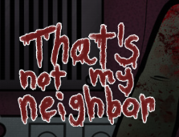

# That's Not My Neighbor - PlayStation 3 Port

Fan-made homebrew port of **"That's Not My Neighbor"** for the PlayStation 3 (CFW / PS3HEN), built with open-source toolchain (PSL1GHT v2).



---

## 🎮 DualShock 3 Controls

| Button | Action |
|---|---|
| **Left Analog Stick** | Move Cursor / Magnifying Glass |
| **Cross (✖)** | Confirm / Open Security Hatch / Permit Entry |
| **Circle (●)** | Cancel / Back / Deny Entry |
| **Square (■)** | Inspect Documents / Checklist |
| **Triangle (▲)** | Trigger D.D.D. Emergency Alarm / Call Squad |
| **L1 / R1** | Switch Document Tabs |
| **Start** | Pause Menu |
| **Start + Select** | Exit to XMB |

---

## 📁 Repository Structure

```
thats-not-my-neighbor-ps3/
├── assets/             # Game assets (sprites, audio, fonts)
│   ├── audio/
│   ├── fonts/
│   └── gfx/
├── include/            # C Header files
│   ├── common.h
│   ├── game.h
│   ├── graphics.h
│   └── input.h
├── ps3/                # PS3 Packaging files (ICON0.PNG, PARAM.SFO, package.conf)
├── src/                # C Source files
│   ├── game.c
│   ├── graphics.c
│   ├── input.c
│   └── main.c
├── Makefile            # Build configuration for PSL1GHT
├── Makefile.build      # Compilation targets
└── README.md
```

---

## 🛠️ Requirements & Building

### 1. Prerequisites
- [PS3 toolchain (PS3DEV)](https://github.com/ps3dev/ps3toolchain)
- [PSL1GHT SDK v2](https://github.com/ps3dev/PSL1GHT)
- `make_sfo` and `pkg.py` tools from PS3 homebrew tools

### 2. Environment Variables
Make sure your environment has:
```bash
export PS3DEV=/usr/local/ps3dev
export PSL1GHT=$PS3DEV
export PATH=$PATH:$PS3DEV/bin:$PS3DEV/ppu/bin
```

### 3. Compile
```bash
# Compile ELF and SELF
make

# Generate installable .pkg for PS3
make pkg
```

The resulting `thats-not-my-neighbor.pkg` can be copied to a USB drive (`FAT32`) and installed via **Package Manager** on PS3 (CFW / HEN).

---

## ⚖️ Disclaimer & Credits

- Original game created by **NachoSama**.
- This is a non-commercial, fan-made homebrew port for educational and preservation purposes.
- All original game characters, art and audio assets belong to the original developer.
